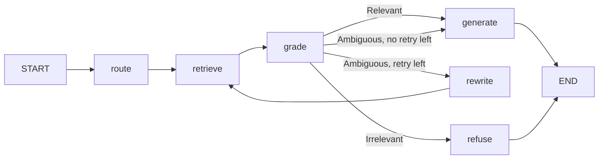

# Belastingdienst RAG prototype

A question-answering prototype over Dutch income tax law (Wet IB 2001) and four court rulings, for employees of the Dutch Tax Administration. It shows three things from the assessment brief:

- **System 1 / System 2:** simple questions go to Claude Haiku (fast, no thinking), complex or uncertain ones to Claude Sonnet (adaptive thinking).
- **Corrective RAG:** a grader decides per question whether to answer, escalate or refuse, as a LangGraph state machine.
- **RBAC:** every search is filtered by the user's role inside the vector database, so a helpdesk employee can never retrieve an internal instruction or a FIOD file.

Every threshold and setting comes from a measurement in the notebooks; [`app/config.py`](app/config.py) lists each value with the number behind it.

## Quick start

You need Docker and an Anthropic API key.

```bash
cp .env.example .env          # then paste your key after ANTHROPIC_API_KEY=
docker compose up --build
```

The first build downloads PyTorch (CPU) and the two local models, so it takes a few minutes. Then open <http://localhost:8000>, pick a user, and ask a question. The Qdrant dashboard is at <http://localhost:6333/dashboard>.

What starts:

| Service | What it does |
|---|---|
| `qdrant` | Vector database: dense (e5) and sparse (BM25) vectors per chunk |
| `ingest` | Loads `data/` into Qdrant, then exits |
| `api` | FastAPI on port 8000: the web page and `POST /ask` |

## How a question flows



| Step | What happens | Cost |
|---|---|---|
| `route` | Language by word counts; simple or complex by a logistic regression on the query embedding | ~14 ms (T4) |
| `retrieve` | Hybrid search (dense + BM25, RRF) inside Qdrant with the role filter, then the mMiniLM reranker; at most 2 chunks per document | ~130-190 ms |
| `grade` | The reranker score of the best chunk against two thresholds: Relevant, Ambiguous or Irrelevant | 0 ms |
| `generate` | Haiku for simple + Relevant; Sonnet for complex or Ambiguous, with a status message first | LLM |
| `refuse` | A fixed message, no LLM call | 0 ms |
| `rewrite` | Haiku rewrites the question into legal Dutch for one more search. Off (`MAX_RETRIES = 0`): one rewrite costs ~913 ms and does not fit the 1.5 s budget | ~780 ms |

## API

```bash
curl -s localhost:8000/ask \
  -H "Authorization: Bearer demo-helpdesk" \
  -H "Content-Type: application/json" \
  -d '{"question": "Mag ik de kosten van mijn werkkamer thuis aftrekken?"}'
```

The token decides the role (`demo-helpdesk`, `demo-inspector`, `demo-fiod`); the request body cannot. In production the token comes from the Tax Administration's login (SSO). The response carries the answer, which system answered, the grade, the sources, the time to first word and a per-step trace.

## Run without Docker

```bash
python -m venv .venv && source .venv/bin/activate
pip install torch==2.14.1 --index-url https://download.pytorch.org/whl/cpu
pip install -r requirements.txt
export ANTHROPIC_API_KEY=...   # or put it in your shell profile, never in the code
uvicorn app.main:app
```

Without `QDRANT_URL`, Qdrant runs inside the Python process and the app loads `data/` at startup.

## Project layout

```
app/
  config.py     every decision, with the measurement behind it
  encoders.py   e5 embedder and mMiniLM reranker
  search.py     hybrid search, role filter, ECLI lookup, max 2 chunks per document
  ingest.py     chunks -> Qdrant
  router.py     language + simple/complex classifier
  llm.py        Claude calls, prompts, source formatting
  graph.py      the CRAG state machine (LangGraph)
  main.py       FastAPI
  static/       the web page
data/
  chunks_v2.csv     Wet IB 2001 (per lid) and four rulings, from the notebooks
  mock_docs.json    fictitious internal instructions and FIOD files, marked FICTIEF
```

## Data

- Law: Wet IB 2001 from [wetten.overheid.nl](https://wetten.overheid.nl/BWBR0011353), chunked per lid, small lids merged (minimum 300 characters).
- Rulings: four ECLI decisions from [data.rechtspraak.nl](https://data.rechtspraak.nl), chunked per section.
- Internal and FIOD documents are invented for the RBAC test and marked FICTIEF.

## Known limits

- The answer arrives in one piece; streaming to the browser is not built yet, so the status message and the time to first word are measured on the server.
- The local models run on CPU in Docker; the notebook timings were on a T4 GPU.
- Questions that are only an amount or an article number need an exact lookup (planned), like the ECLI lookup.
