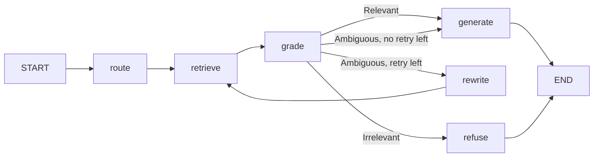

# Belastingdienst RAG prototype

A question-answering prototype over Dutch income tax law (Wet IB 2001) and four court rulings, for employees of the Dutch Tax Administration. It shows three things from the assessment brief:

- **System 1 / System 2:** simple questions go to Claude Haiku (fast, no thinking), complex or uncertain ones to Claude Sonnet (adaptive thinking).
- **Corrective RAG:** a grader decides per question whether to answer, escalate or refuse, as a LangGraph state machine.
- **RBAC:** every search is filtered by the user's role inside the vector database, so a helpdesk employee can never retrieve an internal instruction or a FIOD file.

Every threshold and setting comes from a measurement in the notebooks; [`app/config.py`](app/config.py) lists each value with the number behind it.

## Quick start

You need Docker and an Anthropic API key. Give the key in one of two ways, never in the code:

- **GitHub Codespaces:** add `ANTHROPIC_API_KEY` as a Codespaces secret for this repository (GitHub → Settings → Codespaces → Secrets).
- **Your own computer:** `cp .env.example .env` and paste the key after `ANTHROPIC_API_KEY=`. The `.env` file is in `.gitignore`.

```bash
docker compose up --build
```

In GitHub Codespaces add the second file, because Docker's own DNS does not work there and the containers share the codespace's network instead:

```bash
docker compose -f docker-compose.yml -f docker-compose.codespaces.yml up --build
```

The first build downloads PyTorch (CPU) and the two local models, so it takes a few minutes. Then open <http://localhost:8000> (in Codespaces: the Ports tab, port 8000), pick a user, and ask a question. The Qdrant dashboard is at <http://localhost:6333/dashboard>.

What starts:

| Service | What it does |
|---|---|
| `qdrant` | Vector database: dense (e5) and sparse (BM25) vectors per chunk |
| `ingest` | Loads `data/` into Qdrant, then exits |
| `api` | FastAPI on port 8000: two warm-up searches, then the web page, `POST /ask` and `POST /ask/stream` |

## How a question flows



| Step | What happens | Cost |
|---|---|---|
| `route` | Language by word counts; simple or complex by a logistic regression on the query embedding. Also opens the connection to the Claude API in the background, so the handshake overlaps the search | ~14 ms (T4) |
| `retrieve` | Hybrid search (dense + BM25, RRF) inside Qdrant with the role filter, then the mMiniLM reranker; at most 2 chunks per document | ~130-190 ms (T4), ~0.65 s (4-core codespace) |
| `grade` | The reranker score of the best chunk against two thresholds: Relevant, Ambiguous or Irrelevant | 0 ms |
| `generate` | Haiku for simple + Relevant; Sonnet for complex or Ambiguous, with a status message first | LLM |
| `refuse` | A fixed message, no LLM call | 0 ms |
| `rewrite` | Haiku rewrites the question into legal Dutch for one more search. Off (`MAX_RETRIES = 0`): one rewrite costs ~913 ms and does not fit the 1.5 s budget | ~780 ms |

## API

```bash
curl -s localhost:8000/ask \
  -H "Authorization: Bearer demo-helpdesk" \
  -H "Content-Type: application/json" \
  -d '{"question": "Mag ik de kosten van mijn werkkamer thuis aftrekken?"}'
```

The token decides the role (`demo-helpdesk`, `demo-inspector`, `demo-fiod`); the request body cannot. In production the token comes from the Tax Administration's login (SSO). The response carries the answer, which system answered, the grade, the sources, the time to first word and a per-step trace.

`POST /ask/stream` takes the same request and answers with server-sent events, which the web page uses, so the first word shows up when Claude writes it instead of after the whole answer:

```
data: {"type": "status", "text": "Ik zoek dit grondig uit...", "ms": 412}     System 2 only
data: {"type": "token", "text": "Ja, "}                                       one per piece of the answer
data: {"type": "done", "answer": "...", "system": "...", "trace": [...]}       everything POST /ask returns
```

If Claude is overloaded, rate-limited or times out, `POST /ask` returns 503 and the stream sends `{"type": "error"}` with the reason.

## Tests and evaluation

With the containers running (in Codespaces add `-f docker-compose.yml -f docker-compose.codespaces.yml` after `docker compose`):

```bash
docker compose exec api python -m pytest                    # 64 tests, no LLM calls, no cost
docker compose exec api python -m app.evaluate --search     # golden set: search and grade only, no cost
docker compose exec api python -m app.evaluate              # golden set with the LLM answers (~$0.20)
```

- **pytest** checks the rules that must never break: no role ever receives a chunk above its level (leak test of NB6, every candidate and every final source), at most 2 chunks per document, ECLI as an exact lookup, the answer language, every CRAG path with a fake search and a fake LLM (Relevant, Ambiguous, Irrelevant, ECLI, a model refusal), the threshold edges, and that the role comes from the token and never from the request body.
- **evaluate** runs the golden set in [`app/golden.py`](app/golden.py) (24 answerable questions, each with every source that answers it, plus 10 out-of-scope questions) and prints hit@1/hit@3 per group, the grade per kind of question, refusals, the first word p50/p95 per system and the cost. It exits with code 1 when a release gate in `app/config.py` fails (leaks, hit@3, out-of-scope graded Relevant, out-of-scope answered), so a CI pipeline can block a release.

## Timing on your machine

```bash
docker compose exec api python -m app.bench
```

Times the search and the reranker on the 16 simple questions, at 512 tokens (where the grader thresholds were measured), at 256 tokens (the setting now), and with two pairs scored at once, and shows how far the top score moves and how often the grade would change. Then it times the connection to the Claude API, new and reused, with free `count_tokens` calls. No LLM answers, no cost. Options that changed the grade are listed in `app/config.py`.

## Run without Docker

```bash
python -m venv .venv && source .venv/bin/activate
pip install torch==2.14.1 --index-url https://download.pytorch.org/whl/cpu
pip install -r requirements.txt
export ANTHROPIC_API_KEY=...   # or put it in your shell profile, never in the code
uvicorn app.main:app
```

Without `QDRANT_URL`, Qdrant runs inside the Python process and the app loads `data/` at startup.

## Project layout

```
app/
  config.py     every decision, with the measurement behind it
  encoders.py   e5 embedder and mMiniLM reranker
  search.py     hybrid search, role filter, ECLI lookup, max 2 chunks per document
  ingest.py     chunks -> Qdrant
  router.py     language + simple/complex classifier
  llm.py        Claude calls, prompts, source formatting
  graph.py      the CRAG state machine (LangGraph)
  main.py       FastAPI
  golden.py     golden set, out-of-scope and leak questions
  evaluate.py   golden set report and release gates
  bench.py      timing of search, reranker settings and the API connection
  static/       the web page
tests/          pytest: RBAC, search rules, router, CRAG paths, API
data/
  chunks_v2.csv     Wet IB 2001 (per lid) and four rulings, from the notebooks
  mock_docs.json    fictitious internal instructions and FIOD files, marked FICTIEF
```

## Data

- Law: Wet IB 2001 from [wetten.overheid.nl](https://wetten.overheid.nl/BWBR0011353), chunked per lid, small lids merged (minimum 300 characters).
- Rulings: four ECLI decisions from [data.rechtspraak.nl](https://data.rechtspraak.nl), chunked per section.
- Internal and FIOD documents are invented for the RBAC test and marked FICTIEF.

## Known limits

- The local models run on CPU in Docker; the notebook timings were on a T4 GPU. On a 4-core codespace (two physical cores) the retrieve step takes ~0.65 s instead of 186 ms on the T4, so the first word comes after ~1.4-1.8 s on the server instead of ~1.2 s; most of the spread is Haiku's own first token (0.7-1.1 s).
- Questions that are only an amount or an article number need an exact lookup (planned), like the ECLI lookup.
